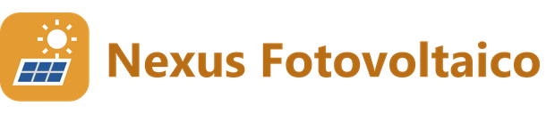

# Nexus Fotovoltaico

Il sinottico animato dell'impianto fotovoltaico in Home Assistant: colleghi una volta le
entità di produzione, consumo e rete e ottieni un dispositivo con i sensori calcolati e una
card che disegna pannelli, inverter, casa e rete e li muove con i valori veri.

L'integrazione non parla con l'inverter: usa entità che Home Assistant ha già (Modbus,
cloud del produttore, contatore, quello che hai). Funziona con qualunque marca.

## Cosa nasce

Un dispositivo col nome che scegli (predefinito «Fotovoltaico») e i sensori che si possono
calcolare con le entità collegate:

| Sensore | Quando c'è | Cosa dice |
|---|---|---|
| **Mappa impianto** | sempre | diagnostico: entità collegate, opzioni e valori calcolati. È il sensore da indicare nella card. |
| **Autoconsumo** | con scambio rete o consumo | la quota di produzione che non finisce in rete, in %. Dallo scambio con la rete se c'è (esatto anche con la batteria), altrimenti dal consumo. Di notte è sconosciuto, non zero. |
| **Verso rete** | con scambio rete | `immissione`, `prelievo` o `fermo` (sotto 5 W). Sconosciuto se lo scambio non si legge. |
| **Verso batteria** | con potenza batteria | `carica`, `scarica` o `fermo`. |

Se togli una fonte da **Configura**, il sensore che ne dipendeva sparisce invece di restare
non disponibile.

## La card

- il flusso in continua corre con la **produzione**, quello in alternata col **consumo**;
- il sole e i pannelli si accendono con la produzione, le finestre di casa col consumo;
- la linea della rete cambia **verso e colore** fra prelievo e immissione;
- con l'accumulo collegato compare la **batteria**, che si riempie con lo stato di carica;
- sotto il disegno, le tessere: verso della rete, autoconsumo, batteria in carica o in scarica.

Verso e autoconsumo non li ricalcola la card: li prende dall'integrazione, con la
convenzione scelta in configurazione. Card e sensori dicono sempre la stessa cosa.

```yaml
type: custom:nexus-fotovoltaico-card
entity: sensor.fotovoltaico_mappa_impianto
title: Fotovoltaico   # facoltativo: senza, il nome dato all'integrazione; "" per nasconderlo
animazioni: true      # facoltativo: false ferma il disegno
```

Si aggiunge anche dall'editor delle plance cercando **Nexus Fotovoltaico**. La card la serve
e la registra l'integrazione: nessuna risorsa da aggiungere a mano.

## Installazione

1. HACS → menu ⋮ → **Repository personalizzate**
2. URL `https://github.com/Pacco24626/nexus_fotovoltaico`, categoria **Integration**
3. Installa e **riavvia Home Assistant**
4. **Impostazioni → Dispositivi e servizi → Aggiungi integrazione → Nexus Fotovoltaico**

## Configurazione

Il modulo arriva già compilato con le entità riconosciute dal nome:

| Sezione | Voci |
|---|---|
| Potenze | **produzione** (obbligatoria), consumo dell'abitazione, scambio con la rete |
| Energie | produzione di oggi, energia prelevata, energia immessa |
| Accumulo | potenza della batteria, stato di carica |
| Convenzioni | come conta il contatore lo scambio con la rete e la batteria |

**La convenzione dello scambio viene proposta guardando i valori di adesso.** Senza batteria
lo scambio con la rete è produzione meno consumo: se ha lo stesso segno, il positivo è
l'immissione; se ha il segno opposto, è il prelievo. Con valori troppo piccoli (meno di 100 W
di differenza) si propone la convenzione più comune, «positivo = immissione»: controlla.

Da **Configura** si cambiano entità, convenzioni e **fondo scala** delle animazioni
(predefinito 3000 W). Se rinomini un'entità collegata, il collegamento si aggiorna da solo.

## Prove

```bash
python tests/test_logica.py
python tests/test_impianto.py
python tests/test_config_flow.py
node tests/test_card.mjs
```

La card si collauda in un browser vero servendo la cartella (`python -m http.server`) e
aprendo `tests/card/prova_card.html`: in fondo alla pagina c'è l'esito dei controlli.

## Licenza

Apache 2.0
